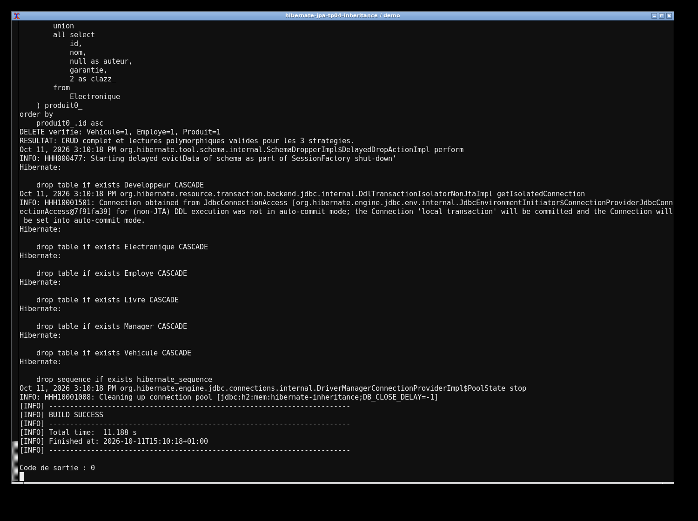
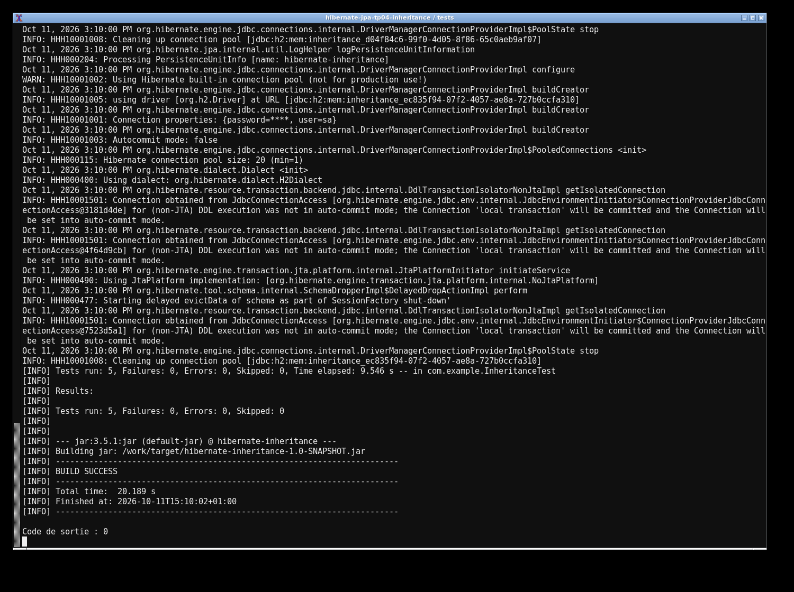

# TP 4 — Héritage avec Hibernate : stratégies de mapping

Dans ce TP, j'ai comparé les trois stratégies d'héritage de Hibernate : SINGLE_TABLE avec les véhicules, JOINED avec les employés et TABLE_PER_CLASS avec les produits.

La démo enregistre une voiture, une moto, un développeur, un manager, un livre et un produit électronique. Elle les relit depuis la base, puis effectue des modifications et des suppressions. Les requêtes SQL permettent de voir les différences entre une table commune, des tables liées et des tables séparées.

Le projet utilise Java 17, Maven et H2 en mémoire. Ces commandes lancent les tests puis la démo :

```sh
mvn clean verify
mvn exec:java
```

Les résultats enregistrés donnent **5 tests réussis, sans échec ni erreur**.

Les captures de la démo et des tests viennent d’exécutions réelles dans le terminal.




